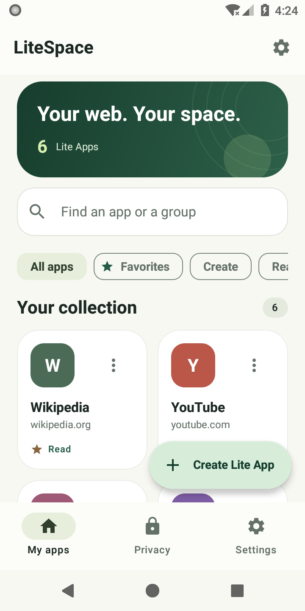
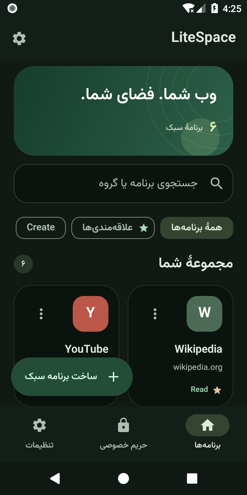
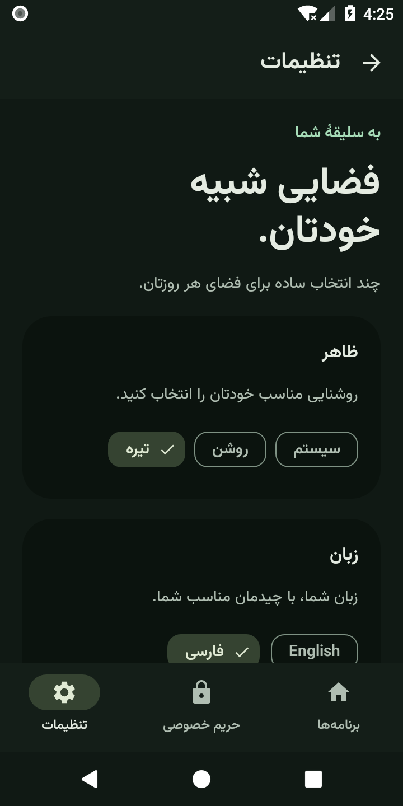
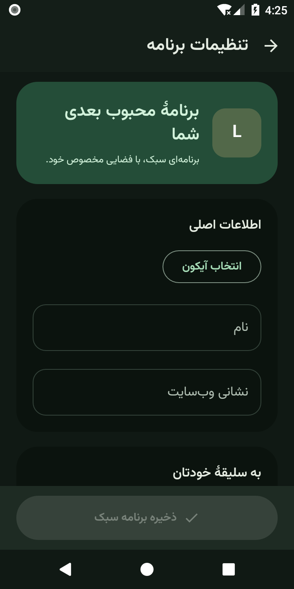

# LiteSpace 1.1 — interface and interaction design

The interface uses forest green, warm neutral surfaces, rounded cards and a clear
reading hierarchy. The collection is the starting point; privacy and settings are
one tap away in the bottom navigation.

## Real Android screenshots

These captures come from the running Android 8 application. Website entries are
created by the device test and removed afterward.

## Collection

- Adaptive card columns, sized for the available width rather than a fixed phone.
- Search by name, website or group; combine search with favorites or a group.
- Distinct empty-collection and no-results states with working recovery actions.
- Favorite and lock indicators; readable site hosts; individual action menus.
- Actual collection counts, localized Persian numerals and animated list changes.
- A persistent, explicitly labeled create action, including for screen readers.
  While filtering, it moves to the app bar to keep recovery actions clear.

## App configuration

A live identity preview sits above clearly grouped essentials and personalization.
Advanced display, permissions and custom code expand on demand. Save remains at
the bottom of the screen and moves above the keyboard. Invalid website addresses
receive inline feedback. URL input uses the URL keyboard without autocorrection;
URLs and code retain left-to-right editing in the Persian interface.

Leaving a changed draft requires an explicit discard confirmation. The baseline
and draft stay in the ViewModel across recreation; icons and code are not written
to Activity saved-state bundles. Existing authentication and permission gates
remain in place.

## Theme, language and settings

The light and dark palettes have separate surface and foreground colors. Persian
uses bundled Vazirmatn 33.003 (SIL Open Font License, included in APK assets),
headlines use normal letter spacing, and navigation/layout mirror in RTL. On older Android versions, system navigation uses the selected theme background
with verified control contrast. Color
and language choices wrap when space is limited, and settings pages scroll.
Android 12+ offers an explicit wallpaper-color switch using Material You. Theme,
language and this switch persist in DataStore. No database migration is needed.

Privacy information is grouped by content blocking, storage, notifications and
private sessions. Counts come from the real blocker. Platform limitations remain
visible. Backup and restore have distinct action cards and explain what the JSON
file includes and excludes.

## Verification

`DesignDeviceTest` exercises actual accessibility actions for search/favorites,
empty-result recovery, persisted theme/language, Activity recreation and mirrored
Persian navigation. `EditorStateDeviceTest` covers large drafts and the new discard
confirmation. Optional screenshot capture uses `-e captureDesign true` and writes
real screenshots to the test application's cache. Sample websites in screenshots
are test-created configurations and are removed after the test; they are not
preloaded into the application.
